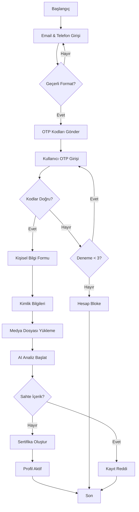
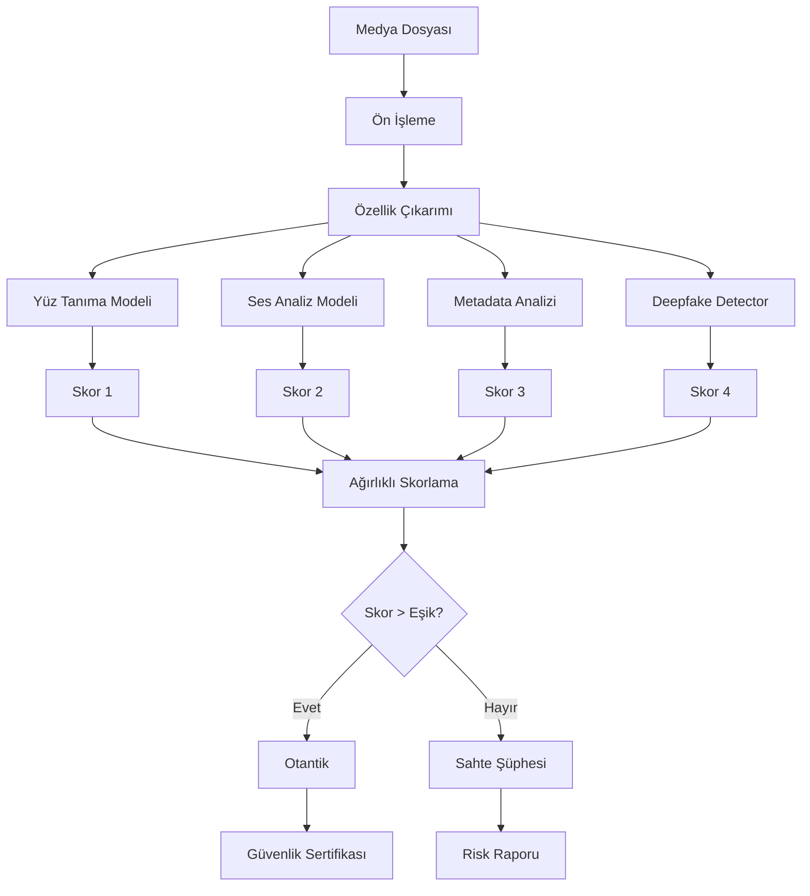
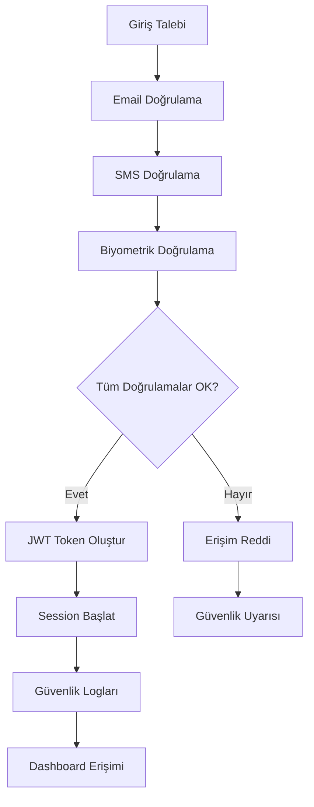
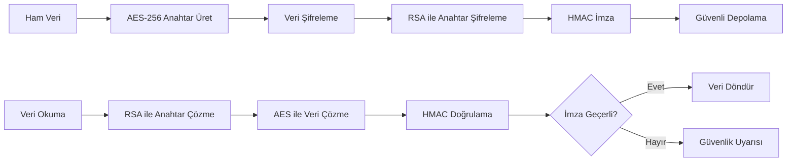
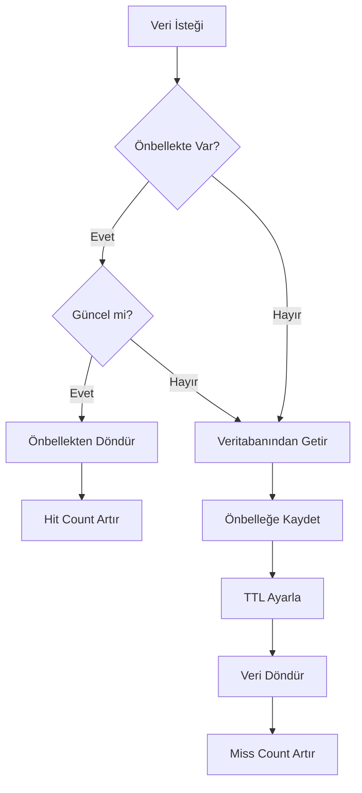
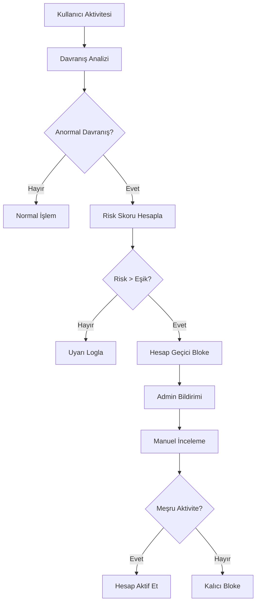
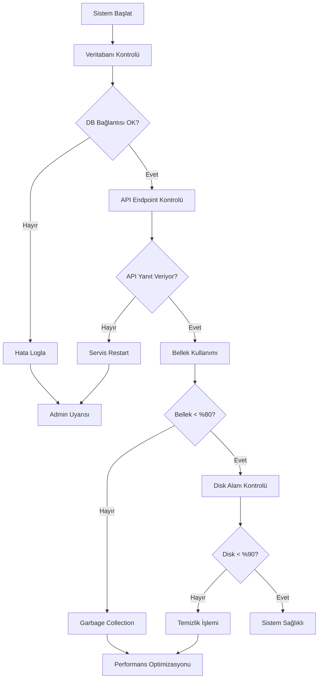
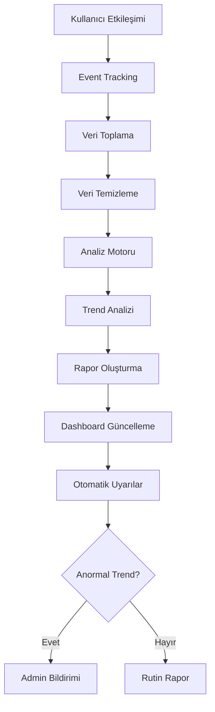

# DigiGuard - Algoritma Akış Diagramları

## 🔄 Ana Algoritma Akışları

### 1. Kullanıcı Kayıt Algoritması

### 2. AI Sahte İçerik Tespit Algoritması

### 3. Güvenlik Doğrulama Akışı

## 🔐 Şifreleme Algoritması Akışı

### Veri Şifreleme Süreci

## 📊 Performans Optimizasyon Algoritması

### Önbellek Yönetimi

## 🚨 Güvenlik Monitoring Algoritması

### Tehdit Tespiti

## 🔄 Sistem Sağlık Kontrolü

### Health Check Algoritması

## 📈 Analitik ve Raporlama

### Kullanım İstatistikleri

Bu algoritma akışları, DigiGuard sisteminin her bir bileşeninin nasıl çalıştığını ve birbirleriyle nasıl etkileşim kurduğunu göstermektedir.