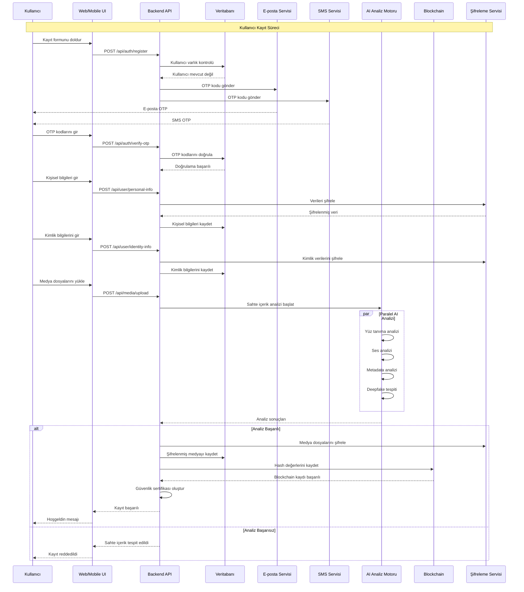
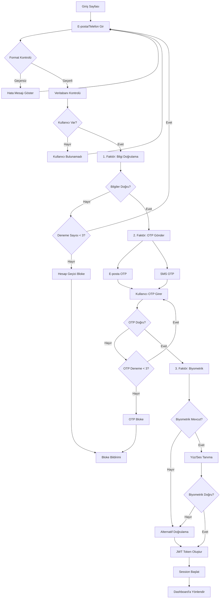
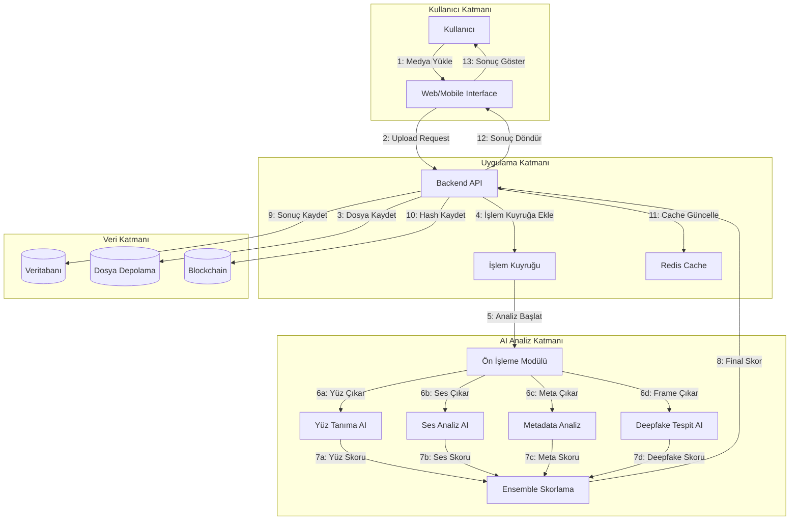
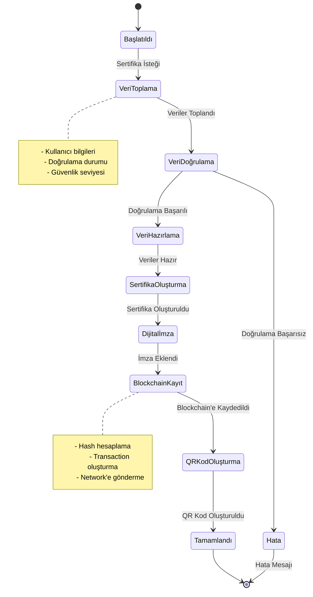
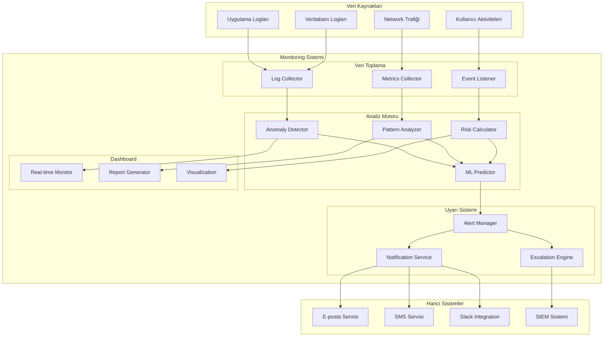
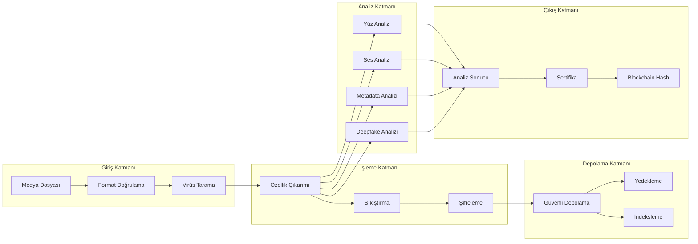
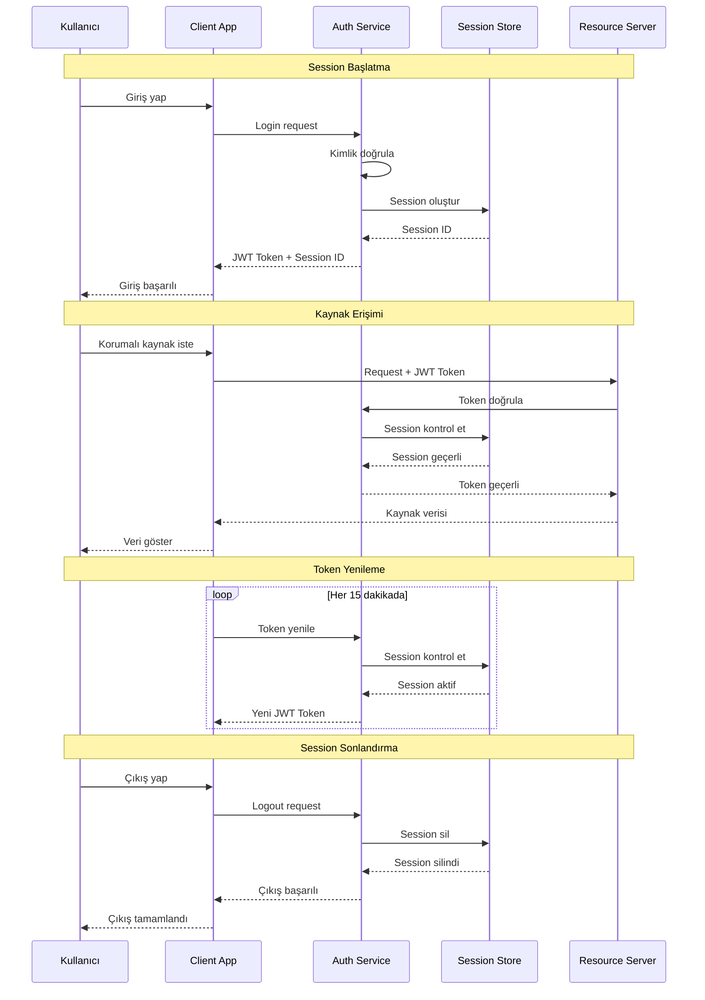
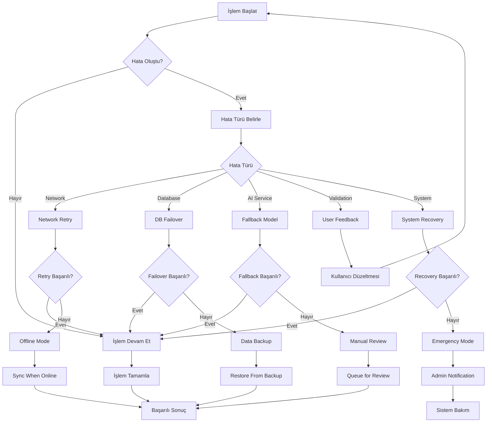

# DigiGuard - Sistem Etkileşim Diyagramları

## 🔄 Etkileşim Diyagramları Koleksiyonu

### 1. Kullanıcı Kayıt Süreci - Sequence Diagram

### 2. Çok Faktörlü Giriş Süreci - Activity Diagram

### 3. AI Sahte İçerik Tespit Süreci - Collaboration Diagram

### 4. Blockchain Sertifika Oluşturma - State Diagram

### 5. Güvenlik Monitoring Sistemi - Component Diagram

### 6. Medya İşleme Pipeline - Data Flow Diagram

### 7. Kullanıcı Session Yönetimi - Timing Diagram

### 8. Hata Yönetimi ve Recovery - Exception Flow

Bu etkileşim diyagramları, DigiGuard sisteminin tüm bileşenlerinin nasıl çalıştığını ve birbirleriyle nasıl etkileşim kurduğunu detaylı bir şekilde gösterir.