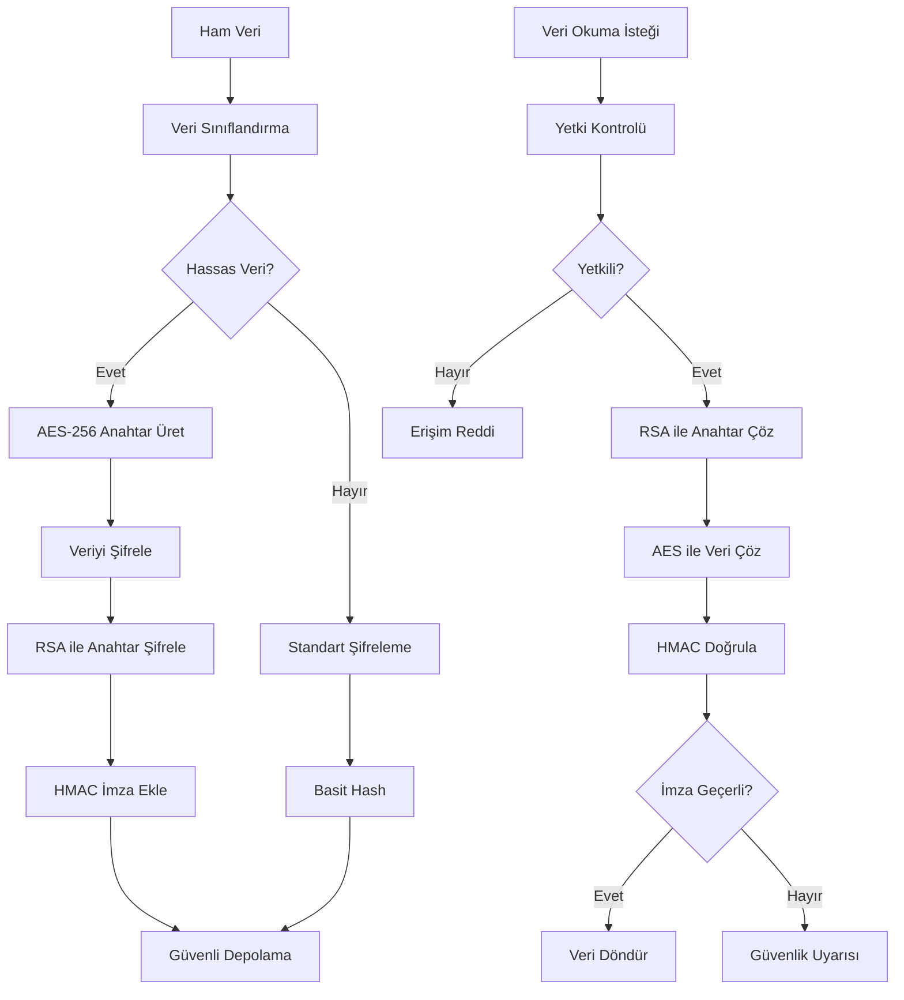

# DigiGuard - Güvenlik Mimarisi

## 🔒 Güvenlik Katmanları

### 1. Çok Katmanlı Güvenlik Modeli

```
┌─────────────────────────────────────────────────────────────┐
│                    KULLANICI KATMANI                        │
├─────────────────────────────────────────────────────────────┤
│ • Multi-Factor Authentication (MFA)                        │
│ • Biometric Verification                                   │
│ • Device Fingerprinting                                    │
│ • Session Management                                       │
└─────────────────────────────────────────────────────────────┘
                              │
                              ▼
┌─────────────────────────────────────────────────────────────┐
│                   UYGULAMA KATMANI                          │
├─────────────────────────────────────────────────────────────┤
│ • Input Validation & Sanitization                         │
│ • CSRF Protection                                          │
│ • XSS Prevention                                           │
│ • Rate Limiting                                            │
│ • API Security                                             │
└─────────────────────────────────────────────────────────────┘
                              │
                              ▼
┌─────────────────────────────────────────────────────────────┐
│                   NETWORK KATMANI                           │
├─────────────────────────────────────────────────────────────┤
│ • TLS 1.3 Encryption                                       │
│ • Certificate Pinning                                      │
│ • HSTS Headers                                             │
│ • WAF (Web Application Firewall)                          │
└─────────────────────────────────────────────────────────────┘
                              │
                              ▼
┌─────────────────────────────────────────────────────────────┐
│                    VERİ KATMANI                             │
├─────────────────────────────────────────────────────────────┤
│ • End-to-End Encryption                                    │
│ • Database Encryption                                      │
│ • Key Management System                                    │
│ • Secure Backup & Recovery                                 │
└─────────────────────────────────────────────────────────────┘
```

## 🔐 Şifreleme Mimarisi

### Hibrit Şifreleme Sistemi

```typescript
interface EncryptionArchitecture {
  // Simetrik Şifreleme (Veri)
  symmetric: {
    algorithm: 'AES-256-GCM';
    keySize: 256;
    ivSize: 96;
    tagSize: 128;
  };
  
  // Asimetrik Şifreleme (Anahtar Değişimi)
  asymmetric: {
    algorithm: 'RSA-OAEP';
    keySize: 2048;
    hashFunction: 'SHA-256';
    mgf: 'MGF1';
  };
  
  // Hash Fonksiyonları
  hashing: {
    passwords: 'PBKDF2-SHA256';
    integrity: 'HMAC-SHA256';
    digital_signatures: 'RSA-PSS';
  };
  
  // Anahtar Türetme
  keyDerivation: {
    function: 'PBKDF2';
    iterations: 100000;
    saltSize: 32;
    outputSize: 32;
  };
}
```

### Şifreleme Akışı



## 🛡️ Kimlik Doğrulama Mimarisi

### Multi-Factor Authentication (MFA)

```typescript
interface MFAArchitecture {
  factors: {
    // Bildiğin Bir Şey (Knowledge)
    knowledge: {
      email: string;
      phone: string;
      otp_codes: {
        email_otp: string;
        sms_otp: string;
        expiry: number; // 5 minutes
        attempts: number; // max 3
      };
    };
    
    // Sahip Olduğun Bir Şey (Possession)
    possession: {
      device_id: string;
      device_fingerprint: string;
      push_notifications: boolean;
      hardware_token?: string;
    };
    
    // Olduğun Bir Şey (Inherence)
    inherence: {
      biometric_data: {
        face_template: string; // encrypted
        voice_template: string; // encrypted
        behavioral_patterns: BiometricPattern[];
      };
    };
  };
  
  security_levels: {
    low: ['email_otp'];
    medium: ['email_otp', 'sms_otp'];
    high: ['email_otp', 'sms_otp', 'biometric'];
    critical: ['email_otp', 'sms_otp', 'biometric', 'hardware_token'];
  };
}
```

### Biyometrik Güvenlik

```typescript
interface BiometricSecurity {
  face_recognition: {
    algorithm: 'FaceNet' | 'ArcFace';
    liveness_detection: boolean;
    anti_spoofing: {
      depth_analysis: boolean;
      texture_analysis: boolean;
      motion_analysis: boolean;
    };
    template_protection: 'Homomorphic_Encryption';
  };
  
  voice_recognition: {
    algorithm: 'i-vector' | 'x-vector';
    features: ['MFCC', 'Spectral', 'Prosodic'];
    anti_spoofing: {
      replay_detection: boolean;
      synthesis_detection: boolean;
      conversion_detection: boolean;
    };
    template_protection: 'Secure_Multiparty_Computation';
  };
  
  behavioral_biometrics: {
    keystroke_dynamics: boolean;
    mouse_movement: boolean;
    touch_patterns: boolean;
    gait_analysis: boolean;
  };
}
```

## 🔍 AI Güvenlik Sistemi

### Sahte İçerik Tespit Mimarisi

```typescript
interface DeepfakeDetectionArchitecture {
  detection_models: {
    // Yüz Tabanlı Deepfake Tespiti
    face_based: {
      models: ['EfficientNet-B4', 'Xception', 'ResNet-50'];
      ensemble_method: 'Weighted_Voting';
      preprocessing: {
        face_extraction: 'MTCNN';
        alignment: 'Similarity_Transform';
        normalization: 'Z_Score';
      };
      features: [
        'Temporal_Inconsistencies',
        'Spatial_Artifacts',
        'Frequency_Domain_Analysis',
        'Physiological_Implausibilities'
      ];
    };
    
    // Ses Tabanlı Sahte Tespit
    voice_based: {
      models: ['RawNet2', 'AASIST', 'SENet'];
      features: [
        'Spectral_Features',
        'Cepstral_Features',
        'Prosodic_Features',
        'Linguistic_Features'
      ];
      anti_spoofing: {
        replay_detection: 'GMM_UBM';
        synthesis_detection: 'CNN_LSTM';
        conversion_detection: 'ResNet_Attention';
      };
    };
    
    // Metadata Analizi
    metadata_analysis: {
      exif_analysis: boolean;
      compression_artifacts: boolean;
      device_fingerprinting: boolean;
      temporal_consistency: boolean;
    };
  };
  
  confidence_scoring: {
    threshold_authentic: 0.85;
    threshold_suspicious: 0.60;
    threshold_fake: 0.40;
    ensemble_weights: {
      face_model: 0.4;
      voice_model: 0.3;
      metadata_model: 0.2;
      behavioral_model: 0.1;
    };
  };
}
```

### AI Model Güvenliği

```typescript
interface AIModelSecurity {
  model_protection: {
    // Model Şifreleme
    encryption: {
      weights_encryption: 'AES-256';
      homomorphic_computation: boolean;
      secure_inference: 'TEE'; // Trusted Execution Environment
    };
    
    // Adversarial Attack Koruması
    adversarial_defense: {
      input_preprocessing: 'Gaussian_Noise_Addition';
      adversarial_training: boolean;
      certified_defense: 'Randomized_Smoothing';
    };
    
    // Model Bütünlüğü
    integrity_verification: {
      model_hashing: 'SHA-256';
      digital_signature: 'RSA-PSS';
      version_control: 'Git_LFS';
    };
  };
  
  privacy_preservation: {
    differential_privacy: {
      epsilon: 1.0;
      delta: 1e-5;
      mechanism: 'Gaussian';
    };
    federated_learning: boolean;
    secure_aggregation: boolean;
  };
}
```

## 🚨 Güvenlik Monitoring

### Gerçek Zamanlı Tehdit Tespiti

```typescript
interface SecurityMonitoring {
  threat_detection: {
    // Anormal Davranış Tespiti
    behavioral_analysis: {
      user_profiling: {
        login_patterns: TimePattern[];
        device_usage: DevicePattern[];
        location_patterns: LocationPattern[];
        interaction_patterns: InteractionPattern[];
      };
      anomaly_detection: {
        algorithm: 'Isolation_Forest' | 'One_Class_SVM';
        threshold: number;
        window_size: number;
      };
    };
    
    // Saldırı Tespiti
    attack_detection: {
      brute_force: {
        max_attempts: 5;
        time_window: 300; // 5 minutes
        lockout_duration: 1800; // 30 minutes
      };
      ddos_protection: {
        rate_limiting: {
          requests_per_minute: 100;
          burst_size: 20;
        };
        ip_blacklisting: boolean;
        captcha_challenge: boolean;
      };
      injection_attacks: {
        sql_injection: 'WAF_Rules';
        xss_protection: 'Content_Security_Policy';
        command_injection: 'Input_Sanitization';
      };
    };
  };
  
  incident_response: {
    automated_response: {
      account_lockout: boolean;
      ip_blocking: boolean;
      alert_generation: boolean;
      evidence_collection: boolean;
    };
    escalation_matrix: {
      low_risk: ['log_event'];
      medium_risk: ['log_event', 'notify_admin'];
      high_risk: ['log_event', 'notify_admin', 'temporary_lockout'];
      critical_risk: ['log_event', 'notify_admin', 'permanent_lockout', 'legal_notification'];
    };
  };
}
```

### Audit ve Compliance

```typescript
interface AuditCompliance {
  logging: {
    security_events: {
      authentication_attempts: boolean;
      authorization_failures: boolean;
      data_access: boolean;
      configuration_changes: boolean;
      privilege_escalations: boolean;
    };
    log_format: 'JSON';
    log_retention: 2555; // 7 years in days
    log_integrity: 'Digital_Signature';
  };
  
  compliance_frameworks: {
    gdpr: {
      data_minimization: boolean;
      consent_management: boolean;
      right_to_erasure: boolean;
      data_portability: boolean;
      privacy_by_design: boolean;
    };
    kvkk: {
      data_controller_registration: boolean;
      explicit_consent: boolean;
      data_inventory: boolean;
      impact_assessment: boolean;
    };
    iso27001: {
      risk_assessment: boolean;
      security_controls: boolean;
      incident_management: boolean;
      business_continuity: boolean;
    };
  };
  
  regular_assessments: {
    vulnerability_scanning: 'Weekly';
    penetration_testing: 'Quarterly';
    security_audit: 'Annually';
    compliance_review: 'Bi_Annually';
  };
}
```

## 🔑 Anahtar Yönetimi

### Key Management System (KMS)

```typescript
interface KeyManagementSystem {
  key_hierarchy: {
    master_key: {
      algorithm: 'AES-256';
      storage: 'Hardware_Security_Module';
      rotation_period: 365; // days
      backup_strategy: 'Shamir_Secret_Sharing';
    };
    
    data_encryption_keys: {
      algorithm: 'AES-256';
      derivation: 'HKDF';
      rotation_period: 90; // days
      escrow: boolean;
    };
    
    key_encryption_keys: {
      algorithm: 'RSA-2048';
      rotation_period: 180; // days
      certificate_authority: 'Internal_CA';
    };
  };
  
  key_lifecycle: {
    generation: 'CSPRNG'; // Cryptographically Secure PRNG
    distribution: 'Secure_Channel';
    storage: 'Encrypted_Database';
    rotation: 'Automated';
    revocation: 'Certificate_Revocation_List';
    destruction: 'Secure_Deletion';
  };
  
  access_control: {
    role_based: boolean;
    multi_person_control: boolean;
    audit_trail: boolean;
    separation_of_duties: boolean;
  };
}
```

Bu güvenlik mimarisi, DigiGuard sisteminin en yüksek güvenlik standartlarında çalışmasını ve kullanıcı verilerinin maksimum korunmasını sağlar.