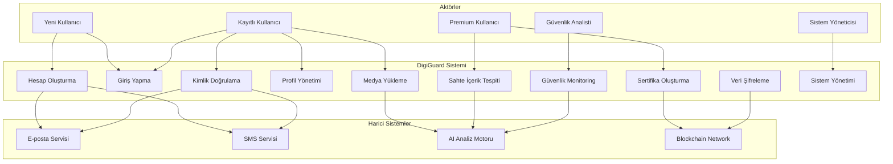
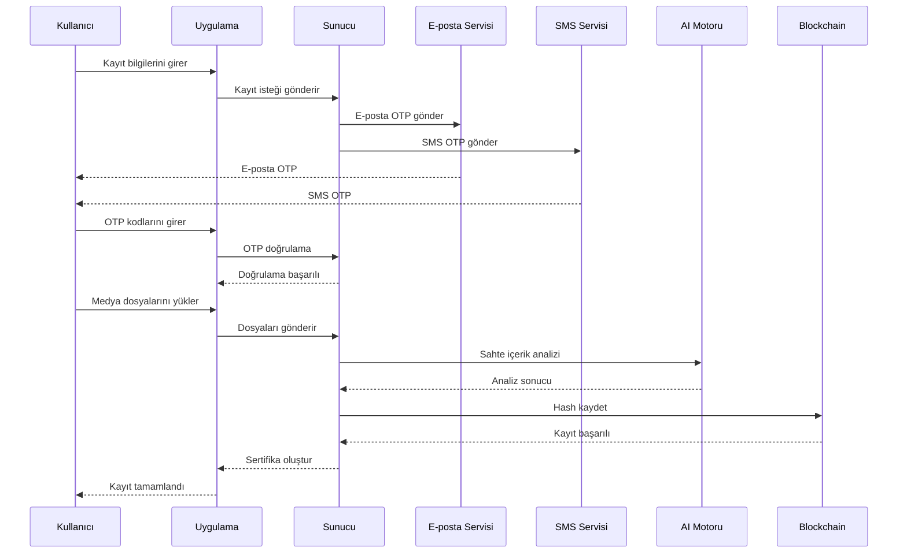
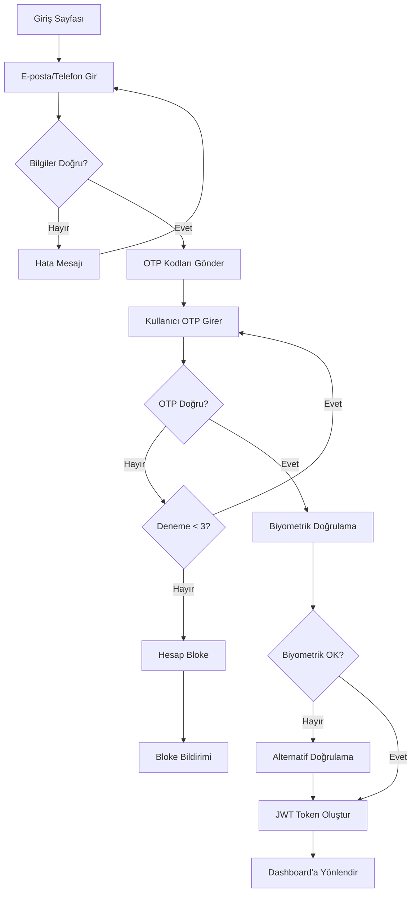

# DigiGuard - Kullanıcı Senaryoları ve Use-Case Diyagramları

## 📋 İçindekiler
1. [Aktörler ve Roller](#aktörler-ve-roller)
2. [Ana Use-Case Diyagramı](#ana-use-case-diyagramı)
3. [Detaylı Kullanıcı Senaryoları](#detaylı-kullanıcı-senaryoları)
4. [Sistem Etkileşim Diyagramları](#sistem-etkileşim-diyagramları)
5. [Hata Senaryoları](#hata-senaryoları)

## 👥 Aktörler ve Roller

### Birincil Aktörler
- **Yeni Kullanıcı**: Sisteme ilk kez kayıt olan kişi
- **Kayıtlı Kullanıcı**: Sisteme daha önce kayıt olmuş, doğrulanmış kullanıcı
- **Premium Kullanıcı**: Gelişmiş özelliklere erişimi olan kullanıcı

### İkincil Aktörler
- **Sistem Yöneticisi**: Sistem bakımı ve güvenlik yönetimi
- **Güvenlik Analisti**: Tehdit analizi ve güvenlik monitoring
- **Teknik Destek**: Kullanıcı sorunlarını çözme

### Harici Sistemler
- **E-posta Servisi**: OTP kodları gönderimi
- **SMS Servisi**: Telefon doğrulama kodları
- **AI Analiz Motoru**: Sahte içerik tespiti
- **Blockchain Network**: Sertifika doğrulama

## 🎯 Ana Use-Case Diyagramı

## 📖 Detaylı Kullanıcı Senaryoları

### 1. Hesap Oluşturma (UC1)

**Aktör**: Yeni Kullanıcı  
**Amaç**: Sisteme güvenli bir şekilde kayıt olmak  
**Ön Koşul**: Kullanıcının geçerli e-posta ve telefon numarası olması  

#### Ana Akış:
1. Kullanıcı uygulamayı açar
2. "Kayıt Ol" butonuna tıklar
3. E-posta ve telefon numarasını girer
4. Sistem OTP kodlarını gönderir
5. Kullanıcı doğrulama kodlarını girer
6. Sistem kodları doğrular
7. Kullanıcı kişisel bilgilerini girer
8. Kullanıcı kimlik bilgilerini girer
9. Kullanıcı medya dosyalarını yükler
10. Sistem AI analizi yapar
11. Sistem güvenlik sertifikası oluşturur
12. Hesap başarıyla oluşturulur

#### Alternatif Akışlar:
- **A1**: Geçersiz e-posta formatı
  - Sistem hata mesajı gösterir
  - Kullanıcı doğru formatı girer
- **A2**: OTP kodu yanlış
  - Sistem 3 deneme hakkı verir
  - 3 başarısız denemeden sonra hesap geçici bloke
- **A3**: AI analizi sahte içerik tespit eder
  - Sistem kayıt işlemini durdurur
  - Kullanıcıya bilgi verilir

#### Başarı Kriterleri:
- Hesap başarıyla oluşturuldu
- Güvenlik sertifikası üretildi
- Kullanıcı dashboard'a yönlendirildi

### 2. Kimlik Doğrulama (UC3)

**Aktör**: Kayıtlı Kullanıcı  
**Amaç**: Çok faktörlü kimlik doğrulama ile güvenli giriş  
**Ön Koşul**: Kullanıcının kayıtlı hesabı olması  

#### Ana Akış:
1. Kullanıcı giriş bilgilerini girer
2. Sistem birinci faktör doğrulaması yapar
3. Sistem OTP kodları gönderir
4. Kullanıcı doğrulama kodlarını girer
5. Sistem ikinci faktör doğrulaması yapar
6. Sistem biyometrik doğrulama ister
7. Kullanıcı yüz/ses tanıma yapar
8. Sistem üçüncü faktör doğrulaması yapar
9. JWT token oluşturulur
10. Kullanıcı dashboard'a yönlendirilir

#### Güvenlik Kontrolleri:
- Rate limiting (dakikada 5 deneme)
- IP tabanlı risk analizi
- Cihaz parmak izi kontrolü
- Anormal davranış tespiti

### 3. Medya Yükleme ve Analiz (UC5)

**Aktör**: Kayıtlı Kullanıcı  
**Amaç**: Kimlik doğrulama için medya dosyalarını güvenli yükleme  
**Ön Koşul**: Kullanıcının doğrulanmış hesabı olması  

#### Ana Akış:
1. Kullanıcı medya yükleme sayfasına gider
2. Fotoğraf dosyalarını seçer ve yükler
3. Video dosyalarını seçer ve yükler
4. Ses kayıtlarını seçer ve yükler
5. Sistem dosya formatı ve boyut kontrolü yapar
6. Sistem virüs taraması yapar
7. Sistem AI tabanlı sahte içerik analizi yapar
8. Dosyalar şifrelenerek saklanır
9. Hash değerleri blockchain'e kaydedilir
10. Kullanıcıya başarı mesajı gösterilir

#### Teknik Gereksinimler:
- **Fotoğraf**: JPG, PNG, max 5MB, min 1920x1080
- **Video**: MP4, MOV, max 50MB, min 30 saniye
- **Ses**: MP3, WAV, max 10MB, min 10 saniye

### 4. Sahte İçerik Tespiti (UC6)

**Aktör**: Premium Kullanıcı  
**Amaç**: Yüklenen medyada sahte içerik tespit etme  
**Ön Koşul**: Premium hesap ve yüklenmiş medya dosyaları  

#### Ana Akış:
1. Kullanıcı analiz edilecek medyayı seçer
2. Sistem ön işleme yapar
3. AI modelleri paralel analiz yapar:
   - Yüz tanıma modeli
   - Ses analiz modeli
   - Metadata analiz modeli
   - Deepfake tespit modeli
4. Sistem ağırlıklı skorlama yapar
5. Güven skoru hesaplanır
6. Risk raporu oluşturulur
7. Sonuçlar kullanıcıya sunulur

#### Analiz Metrikleri:
- **Otantik**: %85+ güven skoru
- **Şüpheli**: %60-85 güven skoru
- **Sahte**: %60 altı güven skoru

### 5. Sertifika Yönetimi (UC7)

**Aktör**: Premium Kullanıcı  
**Amaç**: Dijital kimlik sertifikası oluşturma ve yönetme  
**Ön Koşul**: Tüm doğrulama süreçlerinin tamamlanması  

#### Ana Akış:
1. Sistem kullanıcı verilerini toplar
2. X.509 sertifikası oluşturur
3. Dijital imza ekler
4. Blockchain'e hash kaydeder
5. QR kod oluşturur
6. Sertifika kullanıcıya sunulur
7. İndirme ve paylaşım seçenekleri verilir

#### Sertifika İçeriği:
- Kullanıcı kimlik bilgileri
- Doğrulama tarihi ve seviyesi
- Güvenlik skoru
- Blockchain hash referansı
- Geçerlilik süresi

## 🔄 Sistem Etkileşim Diyagramları

### Kayıt Süreci Sequence Diyagramı

### Giriş Süreci Activity Diyagramı

## ⚠️ Hata Senaryoları

### 1. Ağ Bağlantı Hatası

**Senaryo**: Kullanıcı kayıt sırasında internet bağlantısını kaybeder  
**Sistem Davranışı**:
- Otomatik yeniden deneme (3 kez)
- Offline mod aktif olur
- Veriler yerel olarak saklanır
- Bağlantı geri geldiğinde senkronizasyon

### 2. AI Analiz Hatası

**Senaryo**: AI motoru geçici olarak kullanılamaz  
**Sistem Davranışı**:
- Fallback analiz modülü devreye girer
- Manuel inceleme kuyruğuna alınır
- Kullanıcıya gecikme bildirimi
- 24 saat içinde sonuç garantisi

### 3. Blockchain Ağ Hatası

**Senaryo**: Blockchain ağına erişim sorunu  
**Sistem Davranışı**:
- Hash değerleri yerel veritabanında saklanır
- Periyodik senkronizasyon denenir
- Kullanıcıya geçici sertifika verilir
- Ağ düzeldiğinde kalıcı sertifika

### 4. Biyometrik Doğrulama Hatası

**Senaryo**: Yüz/ses tanıma başarısız  
**Sistem Davranışı**:
- Alternatif doğrulama yöntemleri sunulur
- SMS/E-posta backup kodları
- Güvenlik soruları
- Manuel destek hattı yönlendirmesi

## 📊 Use-Case Metrikleri

### Performans Hedefleri
- **Kayıt Süresi**: < 5 dakika
- **Giriş Süresi**: < 30 saniye
- **AI Analiz Süresi**: < 2 dakika
- **Sertifika Oluşturma**: < 1 dakika

### Güvenlik Metrikleri
- **False Positive Rate**: < %5
- **False Negative Rate**: < %1
- **Sistem Uptime**: > %99.9
- **Veri Şifreleme**: AES-256

### Kullanıcı Deneyimi
- **Başarılı Kayıt Oranı**: > %95
- **Kullanıcı Memnuniyeti**: > 4.5/5
- **Destek Talep Oranı**: < %2
- **Churn Rate**: < %5

Bu use-case diyagramları ve senaryolar, DigiGuard uygulamasının tüm kullanıcı etkileşimlerini kapsamlı bir şekilde tanımlar ve sistem gereksinimlerini netleştirir.